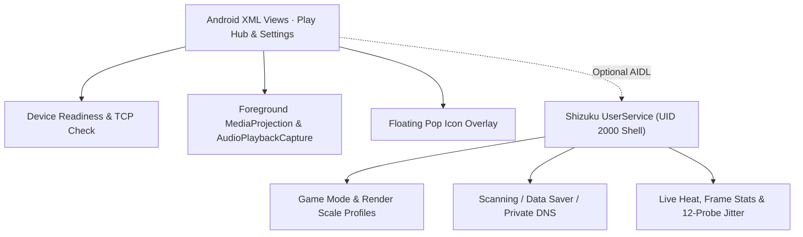

## Executive Summary

**TaDuwa** (`ph.taduwa.app` — *"Duwa ta. Play smart."*) is a lightweight native Android game booster, companion, and gameplay recorder written in **Java 17** using **Android Framework XML Views** (`minSdk 29` / Android 10+, `compileSdk 36`, `targetSdk 36`).

While current testing builds target **Mobile Legends: Bang Bang** (`com.mobile.legends`) first so every profile and diagnostic can be validated cleanly, TaDuwa is being built as a **general-purpose Android game booster and session companion for all games and apps** in future updates.

### What TaDuwa Is (and Is Not)

To avoid any misleading "game booster" claims, TaDuwa enforces strict architectural honesty boundaries:

- **No Game Modification**: Launches games normally via standard Android intents. It never modifies, patches, hooks, or injects into game binaries or APKs.
- **Shizuku Is Optional (No Root Needed)**: Play Hub, Device Check, Screen/Audio Recording, and the Floating Pop Icon work out of the box without Shizuku.
- **Honest Network Diagnostics**: The `Run TCP Check` (`1.1.1.1:443`, 3 attempts) and 12-probe stability/jitter test measure *local connection latency and jitter* — explicitly **not** in-game server ping.
- **Realistic Network Boost Scope**: Network stability controls reduce *local device interference* (background Wi-Fi/BLE scanning, competing background app traffic via Data Saver while keeping the target game whitelisted, and holding `WifiManager.WIFI_MODE_FULL_LOW_LATENCY` during active recording). They cannot override weak Wi-Fi signal, `2.4 GHz` router congestion, or ISP routing.

> **Project Status — In Progress (`v0.5.0` Experimental Prerelease)**: Current builds target *Mobile Legends: Bang Bang* while broader all-app support is on the roadmap. The minified release build, all 29 JVM unit tests, Android release lint, and APK signature verification passed; Shizuku and real-device gameplay behavior are still undergoing testing—use a spare device or practice match rather than a ranked match.

---

## Release & Download (`v0.5.0 — Shizuku Testing Preview`)

Published as an experimental prerelease from the public [samananias/ta-duwa](https://github.com/samananias/ta-duwa) repository:

- **Requirements**: Android 10 or newer (`minSdk 29`). Enable installation from your chosen source when prompted.
- **Verify Your Download**: The [v0.5.0 release page](https://github.com/samananias/ta-duwa/releases/tag/v0.5.0) ships `TaDuwa-v0.5.0-preview.apk` alongside `TaDuwa-v0.5.0-preview.apk.sha256`.
- **Testing Build Signature**: `v0.5.0` is an R8-minified release build signed with a testing certificate. If an older TaDuwa build has a different signature, Android will not update it in place.
- **Safe Teardown**: With Shizuku active, **Reset All Tweaks** requests default device settings and logs any `EXIT=` errors (note that it does not automatically remove the game's unrestricted-data Data Saver whitelist).

---

## Setting Up Shizuku (Optional — No Root)

Play Hub, Device Check, Screen/Audio Recording, and the Floating Pop Icon all work without Shizuku. If you want to use TaDuwa's optional **Shizuku Game Boost & Network Stability** controls, follow these steps to pair and start Shizuku (no root required):

1. **Install Shizuku**: Download and install the official app from [shizuku.rikka.app/download](https://shizuku.rikka.app/download/).

### Android 11 or Newer (Wireless Debugging — Pair & Start)
1. Connect your phone to a **trusted Wi-Fi network**, then open Android **Developer options** and enable **USB debugging** and **Wireless debugging**.
2. Open **Shizuku** and tap **Pairing** under **Start via Wireless debugging**.
3. Open Android's **Wireless debugging** screen, tap **Pair device with pairing code**, and note the 6-digit code.
4. Enter that pairing code directly into **Shizuku's notification** to finish pairing.
5. Return to the **Shizuku** app, tap **Start**, and wait until it confirms **Shizuku is running**.
   - *After a reboot:* You usually do not need to pair again—just open Shizuku on a trusted Wi-Fi network with Wireless debugging enabled and tap **Start**.

### Android 10 (USB / ADB)
- Follow the USB/ADB startup section in the [official Shizuku guide](https://shizuku.rikka.app/guide/setup/#start-by-connecting-to-a-computer) using a trusted computer. You will need to start Shizuku again after rebooting.

### Connect TaDuwa to Shizuku
1. Open **TaDuwa** and go to **Shizuku Game Boost** on the home screen.
2. Before launching a game, switch **Auto-apply when tapping Play in Play Hub** to **OFF** for your first test.
3. Tap **Grant Shizuku Permission**, approve the authorization prompt for TaDuwa, and wait for the status to show **READY**.

### After Testing / Cleanup
- While Shizuku is still running, tap **Reset All Tweaks** in TaDuwa to request default system settings again, and check the reset log for any `EXIT=` errors (restore any manual settings such as the game's unrestricted-data Data Saver exception if needed).
- When finished testing, you can revoke TaDuwa's permission inside Shizuku and turn off **Wireless debugging** / **USB debugging**.

---

## Core Architecture & Engineering Highlights

### 1. Play Hub & Device Readiness Snapshot
- **One-Tap Launch Actions**: Supports **Record & Play** and **Play only** launch flows (currently targeting *Mobile Legends: Bang Bang*, with screen-only fallback if not installed, and designed to generalize across any app/game).
- **Live Device Telemetry**: Reports memory headroom, thermal status, display refresh rate / power saver state, and active network type, plus direct shortcuts to Android **Internet** and **Focus / DND** settings.
- **TCP Handshake Check**: Runs a 3-attempt public TCP handshake check against `1.1.1.1:443` to baseline local connectivity before a match.

### 2. Smart Screen & Internal Game Audio Recorder
- **Adaptive Recording Profiles**:
  - **Smooth 30** *(default)*: locks `720p @ 30 FPS` to keep GPU and encoder load conservative.
  - **Auto (60)**: targets `720p @ 60 FPS` on devices with `>= 6 GiB` RAM and healthy memory/thermals.
  - **Lightweight**: targets `480p @ 24 FPS` (`480p @ 30` fallback) to minimize heat and memory pressure.
  - **High FPS** *(experimental opt-in)*: attempts up to `720p @ 120 FPS` (with `90/60` fallback) on `>= 120 Hz`, `>= 8 GiB` RAM devices with hardware H.264 support.
- **Audio Capture & Media Output**: Supports **Game Audio** (`AudioPlaybackCapture`, subject to Android/app capture policy), **Mic / Speaker**, or **Mute**, with pause/resume support, local MP4 output under `Movies/TaDuwa`, screenshots under `Pictures/TaDuwa`, and `WIFI_MODE_FULL_LOW_LATENCY` lock while actively recording.

### 3. Floating Pop Icon Overlay
- Optional `SYSTEM_ALERT_WINDOW` overlay providing compact recording and screenshot controls during or between matches.
- Supports dragging to a bottom-center dismiss target as well as an idle close (`×`) button.

### 4. Optional Non-Root Shizuku Game Boost (`UID 2000` AIDL)
Powered by [Shizuku](https://shizuku.rikka.app/) via Android Wireless Debugging through an isolated AIDL `UserService` (`IShizukuBoostService.aidl`):

| Capability | Implementation Details |
| :--- | :--- |
| **Game Mode & Render Scale** | `Off` (default), `Performance` (100%), `Smooth GPU` (85%), `Cooling GPU` (75%) |
| **Session & App Quieting** | Stops curated heavy third-party background apps while protecting system/input/Shizuku/target game packages |
| **Network Stability** | Disables background Wi-Fi/BLE scanning, enables Data Saver with target game whitelist, optional Private DNS (`System`, `1.1.1.1`, `dns.google`) |
| **Maintenance & Diagnostics** | Speed pre-compilation (`cmd package compile -m speed`), live heat & frame stats, 12-probe jitter + Wi-Fi radio link diagnostics, and one-tap **Reset All Tweaks** |

---

## Verification & AI-Assisted Authorship

- **Automated Verification**: 29 JVM unit tests (`junit:junit:4.13.2`) covering boost command generation, jitter diagnostics, audio pause state machines, Pop Icon dismiss geometry, and profile selection, alongside R8 minified release builds and Android release lint.
- **AI-Assisted Sole Engineering**: Developed using AI coding tools while personally defining the product roadmap (starting with MLBB and expanding to all apps), non-root Shizuku AIDL boundaries, honest network diagnostic disclaimers, and test verification workflows.
