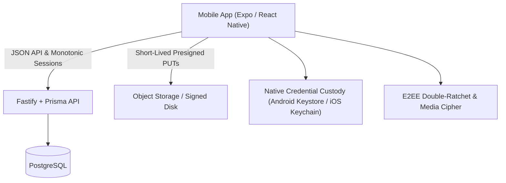

## Executive Summary

**The Nest** is a private, two-person mobile home built for staying connected, organizing everyday plans, and preserving shared memories in a dedicated, distraction-free space.

It is structured as a TypeScript monorepo combining an **Expo / React Native** mobile client (`apps/app`), a **Fastify + Prisma + PostgreSQL** API server (`apps/api`), and shared TypeScript contracts and pure domain engines (`packages/shared`), backed by custom native Android/iOS Expo modules for hardware-backed credential custody, end-to-end encrypted messaging, audio playback, and interactive graphics.

> **Privacy & Repository Notice**: The Nest is built for private personal use, so its source repository, live deployment, and user media remain strictly private. The interactive UI preview above runs entirely in your browser using Pebble & Sprout mascot art and 100% dummy placeholder data (`Pebble & Sprout`), with zero connection to any private deployment or personal data.

---

## System Architecture

### 1. Passwordless Onboarding & Hardware-Backed Token Custody
- **Closed Enrollment Surface**: Open registration and traditional password logins are removed in favor of staged private enrollment and recovery grants (`begin` / `stage` / `commit`).
- **Native Credential Custody**: A custom Expo native module stores sensitive session material inside **Android Keystore (AES-256-GCM)** and **iOS Keychain**, paired with monotonic session rotation and fencing on the backend so stale or replayed session tokens are rejected.

### 2. Direct-to-Storage, Privacy-First Media Pipeline
- **Zero API Binary Relay**: Photo bytes never stream through the API server; the backend issues short-lived presigned upload URLs so the mobile client uploads directly to object storage.
- **EXIF Sanitization & Separation**: Media ingestion strips EXIF GPS location metadata, generates thumbnails, and isolates spoiler-protected **Moments** from the shared **Memories** grid.

### 3. End-to-End Encrypted 1-on-1 Chat & Encrypted Media
- **Double-Ratchet Messaging**: Uses an Olm/Vodozemac E2EE pipeline with tuple-bound Safety Number verification so messages are decrypted only on the two enrolled devices.
- **Encrypted Rich Media**: Supports encrypted photos, streaming AES-256-GCM encrypted short videos with an in-app private player, and native voice message recording/playback.

### 4. Everyday Collaboration & Live Presence
- **Plans, Tasks & Notes**: Shared and personal tasks, calendar events, and collaborative notes guarded by optimistic concurrency revision checks (`expectedRevision`) and unsaved-draft protection.
- **Low-Friction Mobile Experience**: Includes instant zero-loading tab caching, background push wake notifications, and a 4-state live Android home-screen presence widget.

### 5. Shared Interactive Spaces & Cozy Mini-Games
- **Music Room**: Private shared music vault with offline downloads, Server-Sent Events (SSE) synced listening, curated radio streams, and a native Android foreground playback service with lock-screen media controls.
- **Journey Aquarium & Cozy Dino Games**: A backup-excluded multi-species aquarium alongside three shared/offline mini-games — an 8×8 pastel polyomino block puzzle, a server-authoritative 12-plot Dino Farm with continuous weather windows and a daily shop, and an accessible endless runner featuring a reduced-motion Calm Pace mode.

---

## Verification & Key Takeaways

| Engineering Dimension | Implementation & Verification |
| :--- | :--- |
| **Monorepo Contracts** | Shared TypeScript types and pure game/domain engines across client and server workspaces |
| **Offline Test Suite** | 140 verification suites executing with zero external database or network dependencies, plus preflight checks and full workspace typechecking |
| **Media & Privacy Hygiene** | Direct-to-storage presigned uploads, EXIF GPS stripping, E2EE chat & media, and hardware-backed native token custody |
| **AI-Assisted Authorship** | Engineered with AI coding tools while personally directing product design, privacy boundaries, threat models, schema contracts, and verification runs |
